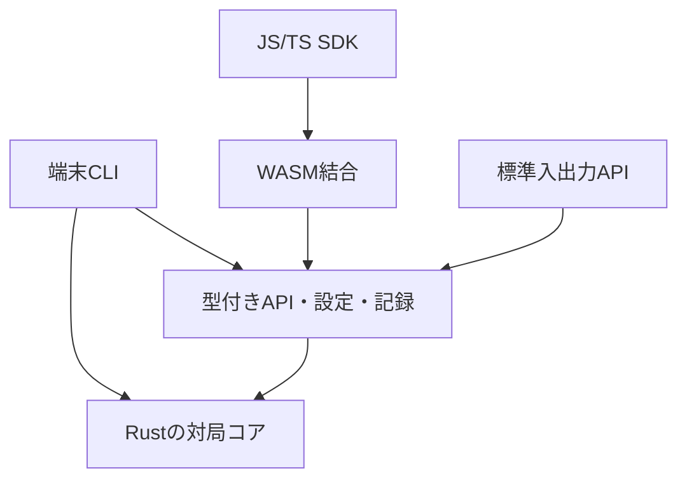

# 責務と依存関係：0.2.0

## パッケージの境界

麻雀の規則はRustの核に一度だけ実装します。外部入力・画面・保存形式は別の責務です。
AIの設定やログを使う端末クライアントも、共通APIの型と検証を再利用します。

| 部分 | 場所 | 責務と依存 |
|---|---|---|
| core | `src/`、クレート`suzume` | 牌、和了形、役と点数、対局、AI。Rust標準ライブラリのみ |
| API | `crates/suzume-api/` | 型付きJSON/TOML、閲覧席、操作の版、研究環境、JSONL。coreへ依存 |
| CLI | `crates/suzume-cli/` | 日本語の行入力画面、自動対局、共通設定と記録。coreとAPIへ依存 |
| WASM | `crates/suzume-wasm/` | APIをWebAssemblyから呼び出す結合。規則の再実装を持たない |
| SDK | `packages/suzume/` | 生成型、入出力の実行時検査、Node.js/ブラウザ用入口 |
| ブラウザ例 | `examples/browser/` | SDKを使う最小画面。ルール・得点・算法を複製しない |

通常の開発・結合は固定Rust 1.100.0、coreのみ最小系列1.80.1でも検査します。
APIの直列化・TOML・ハッシュ、WASM結合の外部依存を、coreへ逆流させません。

## core内部の責務

| モジュール | 責務 | 主な依存 |
|---|---|---|
| `tile` | 検証済みの牌型、表記、ドラ変換 | 基本契約 |
| `hand` | 和了形の列挙、待ち牌、向聴数 | 牌型 |
| `scoring` | 和了牌の割当て、役、符、基本点 | 和了形、宣言した規則 |
| `contracts` | 小さな境界検査と保存条件 | ルール定数、内部の生成比較仕様 |
| `game` | 局面、合法手、操作の適用、精算 | 牌、和了形、点数、契約 |
| `ai` | 公開観測と合法手から判断し、説明を返す | 牌、向聴数、観測・操作の型 |

`lib.rs`は端末に依存しない処理を公開します。coreはファイル、標準入力、標準出力を操作しません。
`ui`と実行ループはCLIクレート内です。規則の汎用処理系や、用途のない抽象階層は追加していません。

## 操作を受け付け、確定する

対局を進める入口は`Game::apply(player, action)`です。合法手は`legal_actions`で取得します。
一覧を無視して不正な操作を渡した場合も、coreが拒否します。

0.2.0では局面だけを候補へ複製し、候補への操作と不変条件の検査に成功してから確定します。
過去の`history`と表示用`events`を各操作の候補へ含めず、新しい記録だけを追記します。
失敗して`Err`を返す場合は元の局面と履歴を変更しません。
通常の`Game::clone`や研究用`fork`は完全複製であり、この操作適用時の工夫と混同しません。
詳しい変更根拠は[公開境界と生成仕様](contracts/platform-boundaries.md)にあります。

局面は打牌待ち、他家の応答待ち、局終了、対局終了に分かれます。
全員の応答を集めてから、ロン、ポン/槓、チーの順で解決します。
リーチ宣言牌で放銃した場合は成立しないため、供託の移動を応答解決まで保留します。
鳴いた捨牌は河に履歴を残し、物理的な所有は副露へ移します。

### 状態を守る契約

各操作の前後に、次を検査します。

- 各種4枚、牌山・王牌・手牌・副露・鳴かれていない捨牌の合計136枚。
- 王牌14枚、槓の回数が宣言した上限以内。
- 打牌待ちはその席だけ構造上14枚、他は13枚。応答待ちは全員13枚。
- 局終了・対局終了は各席13枚または14枚で、14枚は最大1人。槓子は構造上3枚として数える。
- 4人の持点と供託の合計が初期総点に一致。
- リーチ者が門前を維持し、応答待ちの捨牌が実際の河と対応。

これらは役の正しさやすべての進行規則の証明を代替しません。
役・符・精算・振聴・鳴きなどは独立した具体例と対局の検査を併用します。

## 公開APIと情報の境界

APIの入口でJSONの版・型・範囲・未知項目・重複項目・入力サイズを検査します。
席・牌・添字・行動IDは境界付きの型、64bitの種と評価値は正確な十進文字列です。
操作時にセッションIDと更新番号を照合し、古い画面の操作を拒否します。
SDKの型定義だけを根拠に入力を信用せず、実行時にも検査します。

| 入力・状態 | 利用者 | 含める情報 |
|---|---|---|
| coreの`Game`、全情報getter | 信頼するローカル実行系・完全再生 | 山の種、全員の手牌などを含み得る内部状態 |
| `Observation` | `Policy`を実装したAI | 自分の手牌と公開情報。山順序・他家手牌を含めない |
| 固定閲覧席の`GameView` | TUI以外の通常画面・外部API | 自席の非公開情報と公開卓上情報。合法手は閲覧席の手番だけ |
| 閲覧席なしの`GameView` | 公開観戦・共有ログ | 公開卓上情報のみ。私的な応答内容や手牌添字を含めない |

coreをそのまま直列化しません。APIは対局開始後の閲覧席切替を提供しません。
一方、ローカル実行環境の所有者に内部メモリーや自分で指定した種を隠す仕組みではありません。
通信・認証・複数利用者間の権限管理は、将来のサーバー側の責務です。

## 設定・AI・研究環境

[共通設定](api/configuration.md)をTOMLとJSONから同じ`AppConfig`へ読み込みます。
プリセットを解決し、明示された予算などを上書きし、組合せを検査して`ConfiguredAi`を作ります。
CLI・API・再生ログの実効AI値を一致させ、同じ設定名だけを記録して実使用とずれることを防ぎます。

`Policy`は観測と合法手を受けて操作を返す差替え点です。
標準の三算法は状態を変更せず、OS乱数や時刻を参照しません。
向聴計算の実行回数で予算を管理し、未計算の値を計算済みの0として扱いません。
[判断説明](ai/README.md)は算法・実効値・候補・計算量を含みますが、正確な勝率や期待得点ではありません。

[研究用環境](api/environment.md)は通常の閲覧席APIとは別のモードです。
次の手番の観測、189要素の合法行動マスク、1席1操作の`step`、4席の点数差報酬を返します。
通常終局と操作上限の打切りを区別します。木探索や学習器の内部状態、仮説局面、報酬の追加設計は利用側で保持します。

## 記録・再生・解析

[mjsonログ](logging/README.md)は、配牌・ツモ・打牌・副露・立直・精算を意味イベントとして記録する既定形式です。
外部の赤牌・未知牌・加槓・複数和了は、限定されたcoreの牌・操作型とは別のmjai型で保持します。
書込み器は成功したcore操作から確定済みイベントを取り出し、内部のPassや不採用の鳴きを出力しません。

Rustのパーサは行・件数・総バイトを制限し、重複キー、牌の増減、イベント順序、点数/供託を検査します。
局面復元は記録された情報に基づき、外部の全採用規則をcoreで再計算する機能ではありません。
AI用観測は指定席の手牌と公開情報だけを返し、記録の終了・局の終了・正常終局を区別します。
TSの構造パーサは生成型を利用し、意味解析はnative/WASMの同じRust実装へ委譲します。

[注釈付きmjai](logging/annotated-mjai.md) は原イベントと任意の解析注釈を分けて保存する形式です。
解析用の型・数値から原文を再生成せず、RustはRawValue、SDKは字句範囲を使って原文を保持します。
標準との変換では入力と出力の上限を検査し、非空注釈を取り除く操作だけを明示指定にします。
注釈は局面復元、既知牌項目からの赤牌集計、AIの視点別観測へ混入させません。
この判断と保存の限界は [ADR 0008](adr/0008-annotated-mjai.md) に記載しています。

[旧JSONL形式](logging/legacy-jsonl.md)のreplay/publicは明示指定で保持します。
replayは種・設定・操作・任意のAI判断を保存し、同じcoreの全操作を再適用して完全一致を確認します。
189行動ID・報酬・終了を持つDatasetTransitionもこの厳密再生から作ります。
mjsonに未記録の山や内部操作を推測し、完全再生や合法手マスクを生成することはしません。

途中のコールバック出力は未確定です。変換・観測ファイルは入力の末尾まで検証してから新しい出力先へ確定します。
詳細な互換境界と実牌譜の固定入力は[互換性資料](logging/mjai-compatibility.md)、設計判断は[ADR-0007](adr/0007-mjai-records.md)にあります。

## 変更と検証の入口

ルール変更は宣言・実装・生成物・検査・文書を同じ変更で更新します。
外部型はRustからSchemaとTypeScriptを生成し、手書きの型表を別の正本にしません。
新しい画面はAPIを使い、新しいAIは[接続点](ai/extension.md)を使います。
形式検証を追加する場合は契約ID・数式・Rust関数・Kani・Lean定理を対応付けます。

[再現手順](development/reproducibility.md)に、固定ツール、全体検査、WASM/SDK、配布物の独立消費をまとめています。
[ADR一覧](README.md#設計判断adr)と[現行作業書](workdocs/workdoc_Nov23-2026_mjai_annotated.md)から判断と受入条件を追跡できます。
